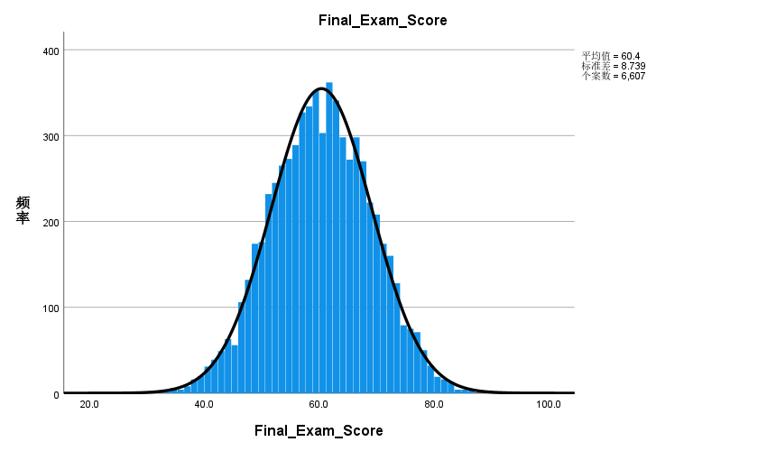
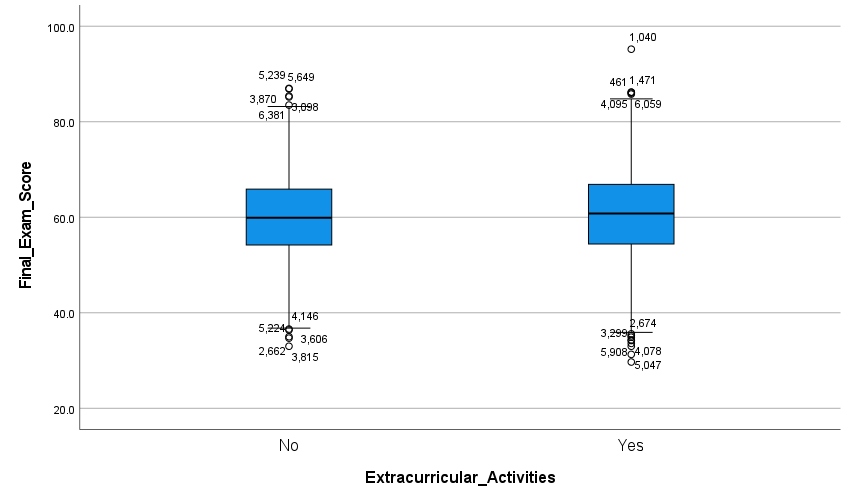
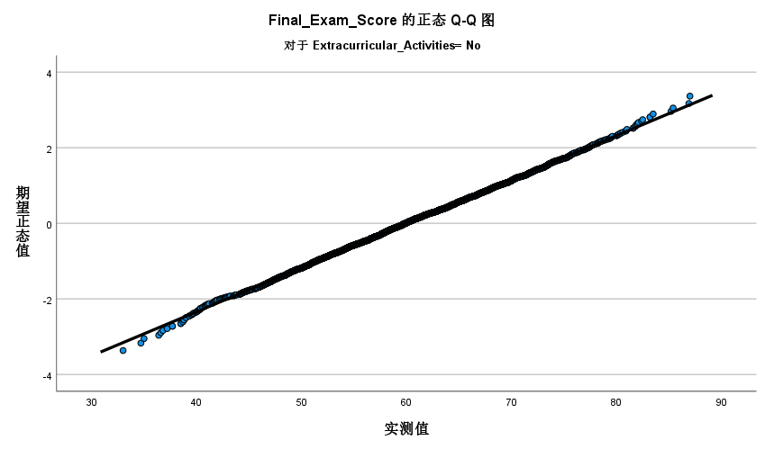
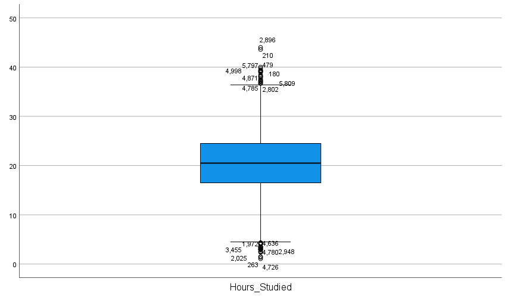

# The Three Major Distributions in Mathematical Statistics and Their Applications
**English | [中文](./README.zh.md)**

## 📌 Project Overview
A statistical analysis project applying the chi-square (\(\chi^2\)), t, and F distributions to a public Kaggle dataset of student academic performance (N = 6,607). 

The goal was not just to produce a "significant" result, but to rigorously work through hypothesis testing—checking assumptions, handling outliers, and interrogating what the p-values actually license us to conclude.

**Dataset:** [Student Performance Factors (Kaggle)](https://www.kaggle.com/datasets/lainguyn123/student-performance-factors)

## 💡 Key Highlights
- **The P-value Trap:** At N = 6,607, a t-test yields a statistically significant difference in scores between students with and without extracurricular activities (p = 0.016). However, the actual difference in means is only 0.5277 points. I documented this to emphasize that *statistical significance does not imply practical significance*—a crucial mindset for evaluating machine learning models.
- **Univariate vs. Multivariate Perspectives:** While univariate tests identified specific marginal differences, multivariate tests (Hotelling's \(T^2\) and Wilks' \(\Lambda\)) revealed no significant joint effect across score, attendance, and study hours. Rather than replacing one with the other, analyzing both marginal and joint distributions provides a more comprehensive and robust statistical picture—essential for understanding high-dimensional feature spaces in AI.
- **Assumption Checking:** Conducted rigorous EDA (Q-Q plots, Levene's test, Box's M test) to validate the assumptions of parametric tests, dealing with slight tail deviations and outliers via the Central Limit Theorem.

## 📂 Repository Structure & Materials
- **Core Analysis (Markdown Reports):**
  1. [Theoretical Foundation: Connections & Multivariate Extensions](./analysis/01_theoretical_foundation.md)
  2. [Univariate Hypothesis Testing in Educational Assessment](./analysis/02_univariate_hypothesis_testing.md)
  3. [Multivariate Hypothesis Testing: Expanding the Feature Space](./analysis/03_multivariate_analysis.md)
- **[`figures/`](./figures/):** Selected key data visualizations and plots.
- **[`presentation/`](./presentation/):** 
  - [Thesis Defense Slides (PDF)](./presentation/slides.pdf) *(Note: If the online preview fails, please click "Download" to view locally.)*
  - [LaTeX Source Code](./presentation/main.tex)

## 📊 Visual Evidence

| Overall Score Distribution & Normality | Group Comparison & Outliers |
| :---: | :---: |
|  |  |
| *Overall score distribution with normal curve.* | *Scores by extracurricular activities.* |

| Q-Q Plot (Normality Check) | Outlier Detection |
| :---: | :---: |
|  |  |
| *Q-Q plot showing slight tail deviation.* | *Extreme outliers in Hours_Studied.* |

## 🛠️ Tools
- **Statistics & Modelling:** Hypothesis Testing (Chi-square, t-test, ANOVA), MANOVA (Box's M, Hotelling's \(T^2\), Wilks' \(\Lambda\)), Descriptive Statistics.
- **Software:** SPSS, LaTeX, Excel.
