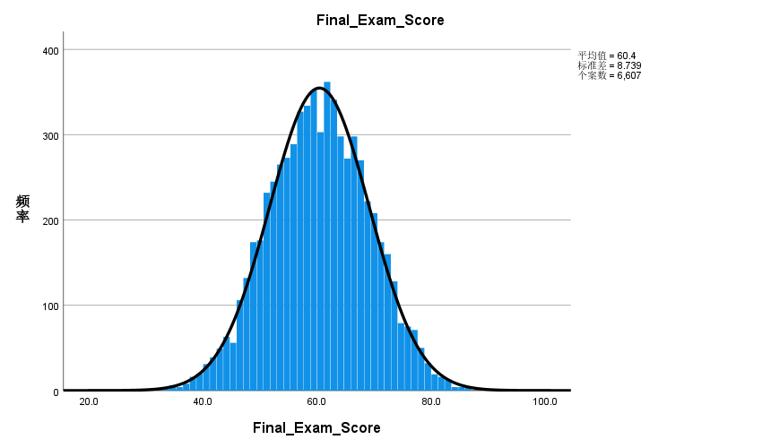
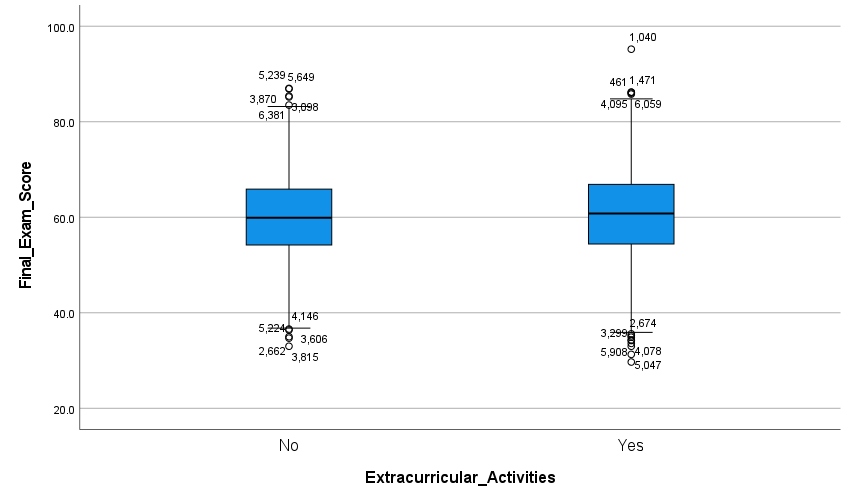
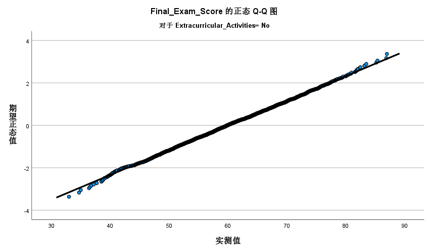
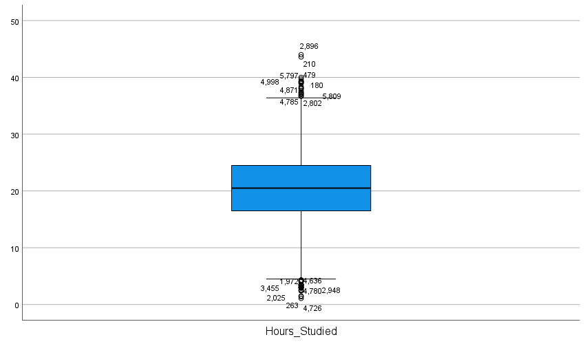

# 数理统计中的三大分布及其应用
**[English](./README.md) | 中文**

## 📌 项目简介
本项目基于 Kaggle 公开的学生学业表现数据集（样本量 N = 6,607），应用了χ2分布、t 分布和 F 分布进行假设检验。

项目的核心目的不仅仅是得出“显著”的结论，而是完整推演了假设检验的流程——包括前提条件检验、异常值处理，以及深度解读 p 值的真实含义。

**数据集来源：** [Student Performance Factors (Kaggle)](https://www.kaggle.com/datasets/lainguyn123/student-performance-factors)

## 💡 核心亮点
- **大样本下的 p 值陷阱：** 在 N = 6,607 的样本下，t 检验显示参加课外活动的学生成绩显著更高（p = 0.016）。但两组的实际均值差仅为 0.5277 分。我在此指出了“统计学显著并不等于实际意义显著”——这一思维对于评估机器学习模型至关重要。
- **单变量与多元视角的结合：** 单变量检验发现了特定的边缘差异，而多元检验（霍特林 T2 和威尔克斯 Λ）表明在联合空间中主效应并不显著。两者并非替代关系，将边缘分布与联合分布结合分析，能够提供更加全面、稳健的统计图景——这对于理解 AI 中的高维特征空间至关重要。
- **严谨的前提假设检验：** 通过 Q-Q 图、Levene 检验、博克斯 M 检验等进行了严格的探索性数据分析（EDA），并结合中心极限定理妥善处理了尾部偏离和离群值。

## 📂 仓库结构与材料
- **核心分析（Markdown 报告）：**
  1. [理论基础：内在联系与多元推广](./analysis/01_theoretical_foundation.zh.md) | [English](./analysis/01_theoretical_foundation.md)
  2. [教育评估中的单变量假设检验](./analysis/02_univariate_hypothesis_testing.zh.md) | [English](./analysis/02_univariate_hypothesis_testing.md)
  3. [多元假设检验：特征空间的扩展](./analysis/03_multivariate_analysis.zh.md) | [English](./analysis/03_multivariate_analysis.md)
- **[`figures/`](./figures/):** 精选的关键数据可视化图表。
- **[`presentation/`](./presentation/):** 
  - [答辩演示文稿 (PDF)](./presentation/slides.pdf) *(注：如果在线预览失败，请点击 "Download" 下载至本地查看。)*
  - [LaTeX 源代码](./presentation/main.tex)

## 📊 图表证据

| 整体成绩分布与正态性 | 组间对比与异常值 |
| :---: | :---: |
|  |  |
| *带正态曲线的整体成绩分布* | *按是否参加课外活动分组的成绩箱线图* |

| Q-Q 图（正态性检验） | 异常值检测 |
| :---: | :---: |
|  |  |
| *展示尾部轻微偏离的 Q-Q 图* | *学习时长中的极端离群点* |

## 🛠️ 工具
- **统计与建模：** 假设检验（χ2检验、t 检验、方差分析）、多元方差分析（博克斯 M 检验、霍特林 T2、威尔克斯 Λ）、描述性统计。
- **软件：** SPSS, LaTeX, Excel。
